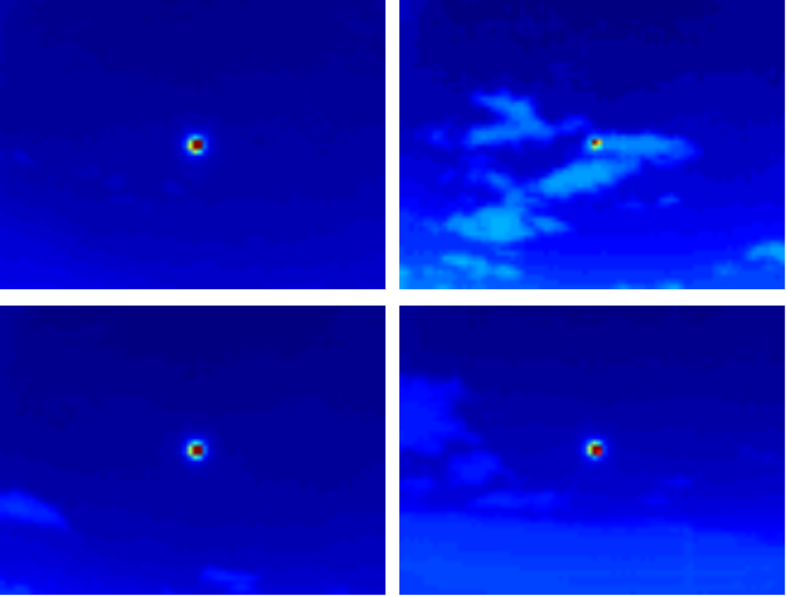
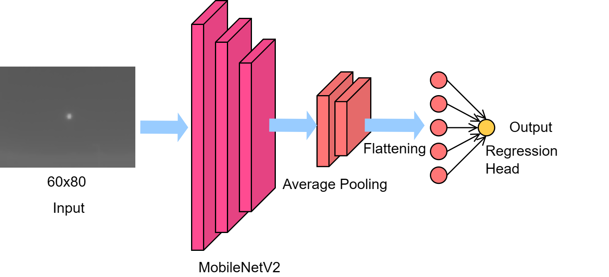
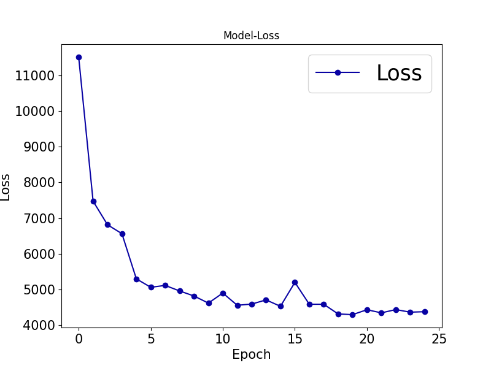

# Intra-Hour Solar Irradiance Estimation Using Infrared Sky Images and MobileNetV2-Based CNN Regression (IEEE EI² 2023 — Extended)

[Ifran Rahman Nijhum](https://sites.google.com/view/ifran-rn), [Paul Kenny](https://people.ucd.ie/paul.kenny), and [Soumyabrata Dev](https://soumyabrata.dev/)

[](https://ieeexplore.ieee.org/document/10512911)
[](https://datadryad.org/dataset/doi:10.5061/dryad.zcrjdfn9m)
[](https://pytorch.org/)

#### News
- **Nov 2026:** This updated version trains on the **full Girasol dataset** (498,265 IR images) with a revised data protocol. See [What's New vs. the Paper](#whats-new-vs-the-paper).
- **2023:** Paper presented at the IEEE Conference on Energy Internet and Energy System Integration (EI²). [Paper](https://doi.org/10.1109/EI259745.2023.10512911)

<hr />

> **Abstract:** *In recent years, the rapid growth in both the development and use of solar energy has spurred intensive research in solar power estimation and forecasting in energy system integration. Solar irradiance, the sun's energy incident on Earth, is subject to fluctuations caused by dynamic atmospheric particulates such as clouds, significantly impacting energy production. Ground-based sky imagers, such as the Total Sky Imager (TSI), have substantially improved forecasting accuracy by capturing essential cloud data. Deep learning models, particularly Convolutional Neural Networks (CNNs), have become pivotal in this field. This paper introduces a novel method for intra-hour solar irradiance estimation using infrared sky images and a CNN-regression model. The primary objective of this research is to achieve real-time accuracy, addressing the critical need for precise solar energy forecasting. The proposed method advances the state-of-the-art by reducing the Root Mean Square Error (RMSE) to an impressive 65.53 W/m². In our study, we leveraged a pre-trained and lightweight MobileNetV2 model, underlining its exceptional effectiveness in enhancing our approach for solar irradiance estimation from infrared sky images. This utilization of advanced pre-trained CNN models underscores the potential for accelerating progress in the field of solar energy forecasting.*

<hr />

## What's New vs. the Paper

This repository is an updated version of the published work. The conference paper trained and tested on a subset of Girasol (one month of training data). This version trains on the **full Girasol dataset** (498,265 images) with a revised data protocol: a chronological 70/30 split, standardized inputs, min-max scaled targets, and a MobileNetV2 trained from scratch. The code and results here reflect the updated version only.

## Dataset

[Girasol](https://datadryad.org/dataset/doi:10.5061/dryad.zcrjdfn9m) (Terrén-Serrano et al., 2021) pairs ground-based infrared sky images (60×80, 16-bit) with global solar irradiance measurements. Samples are shown below (false-colour), from clear sky to scattered cloud.

<p align="center"></p>

## Network Architecture

A MobileNetV2 backbone extracts features from the 60×80 IR image. Global average pooling and flattening feed a single linear regression head that outputs the irradiance.

<p align="center"></p>

## Installation

```
git clone https://github.com/ifran-rahman/solar-irradiance-estimation-dl.git
cd solar-irradiance-estimation-dl
pip install -r requirements.txt
```

The pinned PyTorch build targets CUDA 13.0. For another CUDA version (or CPU), install `torch` and `torchvision` from the [PyTorch selector](https://pytorch.org/get-started/locally/) first, then install the remaining requirements.

## Training and Evaluation

Everything is in [main.ipynb](main.ipynb): data loading, training, and final evaluation.

1. Download Girasol and prepare a CSV with two columns per row, the **image path** and the **irradiance (W/m²)**, in chronological order.
2. Save it as `girasol.csv` in this folder, or point `DATASET_CSV` in the notebook's *Configuration* cell to it.
3. Run the notebook, either interactively in Jupyter or headless:

```
jupyter nbconvert --to notebook --execute main.ipynb \
    --output-dir result/mobilenet_regression_v2 --output main_run.ipynb \
    --ExecutePreprocessor.timeout=-1
```

The best checkpoint (lowest validation RMSE), the per-epoch validation losses, and the loss curve are written to `result/mobilenet_regression_v2/`.

<details>
<summary><strong>Training configuration</strong> (click to expand) </summary>

| Setting | Value |
|---|---|
| Input size | 80×60 (W×H), 3-channel |
| Input normalization | mean 0.3938, std 0.0242 |
| Target scaling | Min-max with training-split min/max (9.27 / 1271.67 W/m²) |
| Loss | MSE |
| Optimizer | Adam, LR 1e-4, weight decay 1e-5 |
| Batch size | 256 |
| LR schedule | ReduceLROnPlateau on validation RMSE (factor 0.1, patience 2) |
| Early stopping | Patience 5 on validation RMSE, max 50 epochs |
| Seed | 42 (deterministic cuDNN, seeded DataLoader workers) |

</details>

## Results

Metrics are computed in W/m² on the held-out 30% split with the best checkpoint. The same split is also used for early stopping and checkpoint selection. Single seed (42).

| Model | Params | RMSE (W/m²) ↓ | MAE (W/m²) ↓ | R² ↑ | Epochs |
|---|---|---|---|---|---|
| MobileNetV2 + linear head (from scratch) | 2.2M | **65.53** | **39.92** | **0.9262** | 25 (early stop) |

Training took about 133 minutes on a single GPU. The executed notebook with full logs is [result/mobilenet_regression_v2/main_run.ipynb](result/mobilenet_regression_v2/main_run.ipynb).

<details>
<summary><strong>Validation loss curve</strong> (click to expand) </summary>

Validation MSE (W/m²)² per epoch.

<p align="center"></p>
</details>

## Repository Structure

```
solar-irradiance-estimation-dl/
├── main.ipynb                     # Training + evaluation notebook
├── requirements.txt
├── assets/                        # README figures
├── scripts/
│   └── saveResults.py             # Loss-curve plotting (saveLossDiagram)
└── result/
    └── mobilenet_regression_v2/   # Checkpoint, losses, loss curve, executed notebook
```

## Citation

If you use this work, please consider citing:

    @inproceedings{nijhum2023mobilenetv2irradiance,
        author={Nijhum, Ifran Rahman and Kenny, Paul and Dev, Soumyabrata},
        booktitle={2023 IEEE 7th Conference on Energy Internet and Energy System Integration (EI2)},
        title={Intra-Hour Solar Irradiance Estimation Using Infrared Sky Images and MobileNetV2-Based CNN Regression},
        year={2023},
        pages={3534-3539},
        doi={10.1109/EI259745.2023.10512911}
    }

## Contact

For questions, please contact ifran.nijhum@ucdconnect.ie.

**Acknowledgment:** We thank the authors of the [Girasol dataset](https://datadryad.org/dataset/doi:10.5061/dryad.zcrjdfn9m) for making it publicly available.

## Our Related Works

- Enhancing Intra-Hour Solar Irradiance Estimation through Knowledge Distillation and Infrared Sky Images. [Code](https://github.com/ifran-rahman/Solar_Estimation_KD)
- Enhanced IR images for photovoltaic estimation. [Code](https://github.com/ifran-rahman/Solar_Enhanced_IR)
